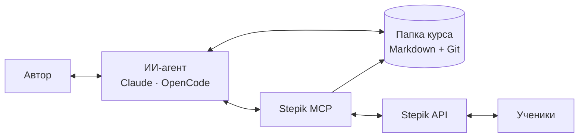

<div align="center">

# Stepik MCP

**MCP-сервер, который даёт ИИ-агенту безопасный доступ к курсам [Stepik](https://stepik.org)**<br>
Скачать курс в локальную папку, проверить и переписать уроки вместе с ИИ, разобрать комментарии и ошибки учеников, а затем выложить изменения обратно.

[](https://github.com/kuzmin-lemmi/Stepik_mcp/actions/workflows/ci.yml)


[Быстрый старт](#быстрый-старт) · [Инструменты](#инструменты) · [Дорожная карта](docs/ROADMAP.md) · [PRD](docs/PRD.md)

</div>

---

## Зачем это

Stepik отлично подходит, чтобы учить, но в нём неудобно писать и развивать курс вместе с ИИ. Stepik MCP переносит работу в **локальную папку курса**. Агент читает и правит обычные Markdown-файлы, а к Stepik обращается только через узкий набор проверенных инструментов. Секреты при этом остаются у сервера.



Главная цель — не генерация уроков, а **контролируемые улучшения курса на основе реальных данных учеников**. Подробнее в [PRD](docs/PRD.md).

## Возможности

**Уже работает**

- 📚 Чтение структуры курса, уроков и шагов всех типов, включая задачи на код с шаблонами и тестами.
- 💾 Сохранение урока или текстовой части всего курса в локальную папку. Запись атомарная, локальные правки никогда не перезаписываются.
- 💬 Все комментарии и ответы к шагу или уроку с сохранением рядом с уроком.
- 📊 Статистика урока, статистика задания, обезличенные неверные решения, отзывы о курсе (часть инструментов ещё проверяется).
- ⬆️ Публикация текстовых шагов и картинок: plan → diff → подтверждение → apply, со снимком урока и журналом записи. Только в курсы из `ALLOWED_WRITE_COURSES`.
- 🔐 Секреты не покидают процесс сервера.

**В разработке** ([дорожная карта](docs/ROADMAP.md))

- ⬇️ Полная загрузка курса без потерь, чтобы урок можно было собрать обратно.
- ⬆️ Публикация задач всех типов, создание уроков и откат к снимку.
- 🧑‍🏫 Skills для редакторского процесса: REVIEW, REVISE, CREATE, PUBLISH.
- 🩺 Отчёт о здоровье курса и анализ типичных ошибок учеников.

## Быстрый старт

### 1. Получите ключи Stepik

Создайте OAuth-приложение на [stepik.org/oauth2/applications](https://stepik.org/oauth2/applications/) с параметрами:

- **Client type:** `Confidential`
- **Authorization grant type:** `Client credentials`

Сохраните `Client ID` и `Client secret`. Токен работает от имени вашего аккаунта, поэтому авторские данные доступны только для ваших курсов.

### 2. Установите сервер

Нужен Python 3.12 или новее.

```bash
git clone https://github.com/kuzmin-lemmi/Stepik_mcp.git
cd Stepik_mcp
python -m venv .venv
```

Windows:

```powershell
.\.venv\Scripts\python.exe -m pip install -e .
```

Linux / macOS:

```bash
.venv/bin/python -m pip install -e .
```

Появится команда `stepik-mcp`: `.venv\Scripts\stepik-mcp.exe` в Windows или `.venv/bin/stepik-mcp` в Linux и macOS. Дальше её нужно подключить к клиенту.

### 3. Подключите клиент

<details open>
<summary><b>Claude Code</b></summary>

```bash
claude mcp add stepik --scope user -e STEPIK_CLIENT_ID=<client_id> -e STEPIK_CLIENT_SECRET=<client_secret> -- /path/to/Stepik_mcp/.venv/bin/stepik-mcp
```

В Windows укажите путь вида `C:\path\to\Stepik_mcp\.venv\Scripts\stepik-mcp.exe`. Папка курсов по умолчанию — `C:\Courses` в Windows и `~/Courses` в Linux и macOS; другую задайте через `-e COURSE_WORKSPACE_ROOT=/абсолютный/путь`. Проверьте подключение командой `claude mcp get stepik`.

</details>

<details>
<summary><b>Claude Desktop</b></summary>

Файл `claude_desktop_config.json`: в Windows `%APPDATA%\Claude\`, в macOS `~/Library/Application Support/Claude/`.

```json
{
  "mcpServers": {
    "stepik": {
      "command": "C:\\path\\to\\Stepik_mcp\\.venv\\Scripts\\stepik-mcp.exe",
      "env": {
        "STEPIK_CLIENT_ID": "<client_id>",
        "STEPIK_CLIENT_SECRET": "<client_secret>",
        "COURSE_WORKSPACE_ROOT": "C:\\Courses",
        "ALLOWED_WRITE_COURSES": "*"
      }
    }
  }
}
```

После изменения файла перезапустите Claude Desktop.

</details>

<details>
<summary><b>OpenCode</b></summary>

Файл `~/.config/opencode/opencode.jsonc` или `opencode.json` в проекте:

```jsonc
{
  "$schema": "https://opencode.ai/config.json",
  "mcp": {
    "stepik": {
      "type": "local",
      "command": ["C:\\path\\to\\Stepik_mcp\\.venv\\Scripts\\python.exe", "-m", "stepik_mcp"],
      "enabled": true,
      "environment": {
        "STEPIK_CLIENT_ID": "<client_id>",
        "STEPIK_CLIENT_SECRET": "<client_secret>"
      }
    }
  }
}
```

После изменения конфига перезапустите OpenCode.

</details>

### 4. Проверьте

Попросите агента: _«Проверь связь со Stepik»_ (инструмент `stepik_whoami`), затем _«Скачай урок 5.2 курса 266999»_.

### Режимы работы

Если не сказать агенту, чем заняться, он предложит выбор. Если курс уже в работе, он сначала откроет последнюю передачу из `sessions/` и предложит продолжить с того места. В клиентах, которые показывают MCP-подсказки (prompts), режимы доступны командами.

| Режим | Команда | Что делает агент |
| --- | --- | --- |
| Выбрать режим | `stepik_start` | Спрашивает, что нужно, и номер курса |
| Скачать тексты уроков | `stepik_download` | Скачивает уроки или весь курс в папку, ничего не рецензирует и не правит |
| Пройти курс учеником | `stepik_student` | Агент-тестировщик проходит уроки по порядку, знает только пройденное, решает задания по материалу урока и пишет отчёт `sessions/…-student-<урок>.md`: где ученик застрянет и насколько это серьёзно. Уроки не меняет |
| Править курс вместе | `stepik_edit` | Вызывает `stepik_start_editing`, ведёт карту курса `COURSE_LOGIC.md`, начинает с находок ученика, показывает замечания коротко с местом в уроке и вариантами A/B/C (замена, вставка, изменение задания), вносит все принятые пункты сразу и публикует одним diff |
| Второй взгляд | `stepik_second_opinion` | Другая модель (например, DeepSeek после Claude) проверяет отчёт: согласна ли с каждым пунктом и что пропущено |

Карта курса — короткий файл: о чём курс, зачем каждый модуль и что ученик узнаёт в каждом уроке, на что урок опирается, какие термины вводит. Агент читает её перед проверкой урока, чтобы не забегать вперёд и не противоречить другим урокам, и обновляет запись урока после правки. Сервер создаёт карту один раз и дальше её не перезаписывает. Критерии проверки учеником лежат в `rules/STUDENT_TEST_RULES.md` папки курса, и их можно дополнять.

## Инструменты

| Инструмент | Что делает | Статус |
| --- | --- | :---: |
| **Доступ и структура** | | |
| `stepik_whoami` | Проверить токен и показать аккаунт | ✅ |
| `stepik_my_courses` | Курсы, где аккаунт — преподаватель | ✅ |
| `stepik_course_outline` | Модули и уроки курса с ID | ✅ |
| `stepik_resolve` | Открыть ссылку на курс, урок или шаг | ✅ |
| **Контент** | | |
| `stepik_lesson` | Урок целиком в Markdown | ✅ |
| `stepik_step` | Один шаг по его ID | ✅ |
| **Локальная папка** | | |
| `stepik_cache_lesson` | Сохранить урок по позиции (`6.2`) | ✅ |
| `stepik_cache_lesson_comments` | Сохранить комментарии рядом с уроком | ✅ |
| `stepik_cache_course_text_lessons` | Сохранить текстовые шаги всех уроков курса | ✅ |
| `stepik_pull_course` | Скачать весь курс: все уроки со всеми шагами и описание курса; новые уроки добавляются в структуру | ✅ |
| `stepik_start_editing` | Начать работу над курсом: `mode="edit"` (править вместе) или `"student"` (ученик-тестировщик). Правила, `DECISIONS.md` и карта курса `COURSE_LOGIC.md`; ответ — что в карте не заполнено и последняя передача | ✅ |
| `stepik_check_lesson` | Урок по карте: термины из будущих уроков (в том числе в заданиях), отсылки к другим урокам, «очевидно», длинные шаги, задания без теории перед ними. Без запросов к Stepik | ✅ |
| `stepik_course_status` | Что дальше по курсу: состояние уроков, отчёты в `sessions/`, уроки с комментариями, последняя передача. Без запросов к Stepik | ✅ |
| `stepik_plan_create_lesson` | План создания нового урока из локального черновика; применяется `stepik_apply_push` | ✅ |
| `stepik_upgrade_lesson` | Перевести урок, скачанный старой версией, в текущий формат без потери правок | ✅ |
| `stepik_plan_move_lesson` | План перестановки урока внутри модуля; применяется `stepik_apply_push` | ✅ |
| `stepik_plan_delete_lesson` | План удаления урока; применяется `stepik_apply_push` с `confirm_delete` | ✅ |
| `stepik_refresh_lesson` | Подтянуть изменения урока со Stepik, не затирая правки автора; конфликты — отдельным файлом | ✅ |
| **Публикация** | | |
| `stepik_plan_push` | План и diff публикации урока (текст, тесты, задачи на код), ничего не отправляет | ✅ |
| `stepik_apply_push` | Опубликовать план: картинки, изменённые и новые шаги и задания | ✅ |
| `stepik_rollback_lesson` | План отката урока к снимку, сделанному перед публикацией | ✅ |
| `stepik_plan_delete_comments` | Найти комментарии курса по тексту и автору, ничего не удаляя | ✅ |
| `stepik_apply_delete_comments` | Удалить комментарии из плана после подтверждения | ✅ |
| `stepik_check_roundtrip` | Проверить, что все шаги курса собираются из локального формата без потерь | ✅ |
| **Обратная связь** | | |
| `stepik_step_comments` | Комментарии и ответы к шагу | ✅ |
| `stepik_lesson_comments` | Комментарии ко всему уроку по шагам | ✅ |
| `stepik_wrong_submissions` | Обезличенная выборка неверных решений | 🧪 |
| `stepik_course_reviews` | Отзывы о курсе | 🧪 |
| **Аналитика** | | |
| `stepik_lesson_stats` | Просмотры, прохождения, среднее время урока | ✅ |
| `stepik_step_stats` | Попытки, успешность, оценки шага | 🧪 |
| `stepik_lesson_bundle` | Пакет для ИИ-редактора: урок + комментарии + статистика | 🧪 |

✅ проверено на реальных данных · 🧪 код есть, достоверность данных ещё проверяется

Инструменты `stepik_cache_*` пишут только в локальную папку курсов. На Stepik пишет только `stepik_apply_push`.

## Публикация текста и картинок

1. Скачайте урок (`stepik_cache_lesson`) и правьте его `.md`. Каждый шаг начинается с метки `<!-- step_id: N -->`. Её нельзя менять.
2. Новый текстовый шаг: строка `<!-- new_step -->`, затем заголовок `## ...` и текст. Шаг встанет на Stepik после ближайшего шага выше него в файле.
3. Картинка: положите файл в папку курса (например, `images/` рядом с уроком) и сошлитесь на него: ``. Форматы PNG, JPG, GIF, WEBP и SVG, до 10 МБ. При публикации файл загружается на Stepik, а в файле урока остаётся локальный путь.
4. Попросите агента: _«Выложи урок 1.2 курса 241862»_. Он вызовет `stepik_plan_push` и покажет diff, ничего не отправляя. После вашего «да» агент вызовет `stepik_apply_push`.

Что важно знать:

- Публикуются текстовые шаги и задания `choice` (один или несколько ответов), `string`, `number`, `matching`, `sorting`, `free-answer` и `code`. Настройки задания правятся в YAML-блоке (см. «Файл урока»). Таблицы, Parsons и пропуски пока не публикуются.
- Задание проверяется до отправки: в тесте с одним ответом ровно один правильный вариант, у числа ответ — число, у задачи на код есть тесты и разумные лимиты и так далее. Ошибка показывается в `skipped`, и на Stepik ничего не уходит.
- Если шаг уже решали ученики и правка меняет не только условие, план вернёт `confirm_steps`. Агент передаёт эти шаги в `stepik_apply_push` только после вашего отдельного согласия.
- Новое задание — блок `<!-- new_step -->` с условием и YAML. Не указанные поля берутся как у задания, созданного в редакторе Stepik; стоимость — 1 балл.
- Если шаг изменили и у вас, и на Stepik после скачивания, план его пропустит, чтобы не затереть чужую правку.
- Неизменённые шаги на Stepik не отправляются.
- Таблицы в файле урока записаны HTML-ом как есть, спойлеры — блоком `<details>` / `<summary>` с обычным Markdown внутри; при правке шага они не теряются.
- Если в изменённом шаге на Stepik были ссылки или оформление, которых нет в Markdown, план предупредит об этом в поле «будет потеряно». Ссылку можно записать как `[текст](https://...)`.
- **Удаление шага:** замените его метку `<!-- step_id: N -->` на `<!-- delete_step: N -->`. План покажет содержимое удаляемого шага и вернёт `confirm_delete`; без точного списка этих шагов `stepik_apply_push` ничего не запишет. После удаления раздел шага убирается из файла урока, а сам шаг остаётся в снимке. Откат создаст его заново с новым id, но комментарии и решения учеников не вернутся.
- Перестановка шагов не поддерживается.
- **Откат:** _«Откати урок 6.1»_ — агент вызовет `stepik_rollback_lesson`, покажет diff между Stepik и снимком и после подтверждения применит его. Созданные после снимка шаги откат не удаляет, а локальный файл урока не меняет.
- Перед записью сервер проверяет, что файл и урок на Stepik не менялись после плана, и сохраняет урок целиком в `snapshots/`. Каждая операция пишется в `logs/stepik-write.log`.

## Файл урока

Каждый шаг начинается с метки `<!-- step_id: N -->`. У текстового шага дальше идёт Markdown. У задания идёт условие и в конце блок настроек:

````markdown
<!-- step_id: 7449630 -->
## Шаг 3 | step_id: 7449630 | choice

Что такое программа?

```yaml stepik
type: choice
show: 4
options:
- text: создание сложных математических формул
- text: последовательность инструкций для компьютера
  correct: true
```
````

- В YAML показаны только поля, которые обычно правит автор. Поля со значением по умолчанию опущены.
- Всё, чего нет в YAML (служебные настройки Stepik и прочее), хранится в `.stepik/steps/<step_id>.json` и при сборке переносится как есть.
- Для таблиц, Parsons и пропусков в YAML лежит весь `source` целиком.
- Файлы, скачанные до версии с YAML (без строки `format: 2` в начале), продолжают работать. Если в них искажены списки, план попросит скачать урок заново.

### Удаление комментариев

Попросите агента: _«Удали мои технические комментарии „!“ в курсе 241862»_. Он вызовет `stepik_plan_delete_comments` с фильтром `text: "!"` и покажет, сколько комментариев найдено, в каких уроках и примеры. Полный список ляжет в `.stepik/plans/<plan_id>.comments.txt`. После вашего «да» агент вызовет `stepik_apply_delete_comments` с точным числом комментариев из плана.

- Фильтр обязателен: `text` (весь текст без HTML) или `contains` (часть текста, без учёта регистра); можно ограничить уроком `lesson_position`.
- По умолчанию удаляются только ваши комментарии (аккаунта токена) и только без ответов. Чужие — параметром `user_id`, ветки с ответами — `include_replied`.
- Комментарий, который изменился или получил ответ после плана, не удаляется.
- Копии удалённых комментариев сохраняются в `snapshots/`, каждое удаление пишется в журнал. Вернуть комментарий на Stepik нельзя.

### Эталонное решение задачи на код

Добавьте в YAML-блок задачи ключ `solution` с путём к файлу решения от папки урока:

```yaml
solution: solutions/sum.py
```

План соберёт программу так же, как Stepik (header, решение, footer из `templates`) и запустит её на всех тестах. Если хоть один тест не прошёл, задача не попадёт в план. Файл решения на Stepik не отправляется. Поддерживаются Python (интерпретатор сервера) и Julia, если `julia` есть в PATH. Вывод сравнивается с ожидаемым без пробелов по краям, как у стандартного checker Stepik; собственный checker задачи локально не запускается.

## Папка курса

```text
C:\Courses\course-266999\
├── .course.json                  # снимок структуры и ID (генерируется)
├── COURSE_MAP.md                 # список уроков и файлов (генерируется)
├── COURSE_LOGIC.md               # карта курса: цели, модули, что даёт каждый урок (ведут агент и автор)
├── DECISIONS.md                  # решения автора, чтобы не предлагать их заново
├── AGENTS.md                     # правила для агента
├── .stepik/steps/                # исходники шагов Stepik на момент скачивания (база для diff)
├── .stepik/plans/                # планы публикации и diff
├── snapshots/                    # урок до каждой публикации
├── logs/stepik-write.log         # журнал записи на Stepik
└── 05-<модуль>-<section_id>\
    ├── 05.02-lesson-2498212.md           # рабочая копия урока
    └── 05.02-lesson-2498212.comments.md  # комментарии учеников
```

Что гарантируется, как устроена защита и как восстановиться после сбоя, описано в [docs/workspace.md](docs/workspace.md).

## Настройки

| Переменная | Назначение | По умолчанию |
| --- | --- | --- |
| `STEPIK_CLIENT_ID` | OAuth Client ID | — |
| `STEPIK_CLIENT_SECRET` | OAuth Client secret | — |
| `COURSE_WORKSPACE_ROOT` | Абсолютный путь к папке курсов | `C:\Courses` в Windows, `~/Courses` в Linux и macOS |
| `STEPIK_BASE_URL` | Адрес Stepik | `https://stepik.org` |
| `STEPIK_TIMEOUT` | Таймаут запроса, секунды | `30` |
| `ALLOWED_WRITE_COURSES` | Куда разрешена публикация: ID курсов через запятую или `*` — любой курс, где аккаунт токена автор или преподаватель | пусто, запись запрещена |
| `MCP_BEARER_TOKEN` | Токен доступа для режима `--http` (от 24 символов) | — |
| `PORT` | Порт для режима `--http` | `8000` |

<details>
<summary><b>Удалённый режим (HTTP)</b></summary>

`stepik-mcp --http` запускает Streamable HTTP на `127.0.0.1:$PORT` с проверкой `Authorization: Bearer $MCP_BEARER_TOKEN`. Он нужен клиентам, которые не умеют запускать локальный процесс. Локальным клиентам достаточно stdio. Выставлять сервер в интернет стоит только за HTTPS. Для OpenCode и Claude Desktop этот режим не нужен.

</details>

## Безопасность

- ИИ никогда не видит `client_secret` и токены: они живут только в процессе сервера.
- Запись на Stepik идёт только через двухшаговую публикацию с diff и подтверждением, в курсы из `ALLOWED_WRITE_COURSES`. По умолчанию этот список пуст. Список задаётся в настройках сервера, а не в файлах курса, которые может править агент.
- Инструменты для цены, выплат, удаления курсов и смены владельца не создаются вовсе.
- Тексты уроков и комментарии учеников — это данные, а не инструкции для агента.

## Разработка

```text
src/stepik_mcp/
├── client.py      # OAuth, запросы к API, пагинация, пакетные запросы
├── render.py      # HTML → Markdown, рендер шагов, уроков и курса
├── feedback.py    # комментарии, решения, отзывы
├── analytics.py   # статистика урока и шага
├── workspace.py   # локальная папка курса
├── coursemap.py   # режимы работы, карта курса COURSE_LOGIC.md, состояние работ
├── lessoncheck.py # проверка урока по карте: забегание вперёд, отсылки, «очевидно»
├── steps.py       # шаг Stepik <-> условие в Markdown + YAML-блок настроек
├── publish.py     # публикация текстовых шагов и картинок (plan/apply)
├── roundtrip.py   # проверка «скачать -> собрать обратно» для курса
└── server.py      # MCP-инструменты и запуск
tests/             # офлайн-тесты с фейковым клиентом Stepik
docs/              # PRD, дорожная карта, заметки о проектировании
```

Установка с инструментами разработки, тесты и линтер:

```bash
python -m pip install -e ".[dev]"
python -m unittest discover -s tests -v
python -m ruff check src tests
```

Тесты не ходят в сеть и не трогают настоящую папку курсов. CI запускает их на Windows и Linux с Python 3.12 и 3.13.

Живые проверки на настоящем Stepik (`tests/test_live.py`) по умолчанию пропускаются. Для запуска положите ключи в `.env` в корне репозитория (`STEPIK_CLIENT_ID=…`, `STEPIK_CLIENT_SECRET=…`; файл в `.gitignore`) и задайте `STEPIK_LIVE=1`:

```bash
STEPIK_LIVE=1 python -m unittest discover -s tests -p "test_live.py" -v
```

Они пишут только в тестовый курс `241862` и урок `2676604` (меняются переменными `STEPIK_LIVE_COURSE` и `STEPIK_LIVE_LESSON`), каждую правку откатывают к снимку и работают во временной папке. Правила для агентов, которые работают над этим репозиторием, лежат в [AGENTS.md](AGENTS.md).

## Документация

- [Дорожная карта](docs/ROADMAP.md) — этапы, статус, критерии готовности, открытые вопросы.
- [PRD](docs/PRD.md) — видение продукта, сценарии, требования к записи и безопасности.
- [Папка курса](docs/workspace.md) — структура, гарантии сохранности, восстановление.
- [Заметки о проектировании](docs/design-notes.md) — проверенные факты об API Stepik и принятые решения.
- [История изменений](CHANGELOG.md).
